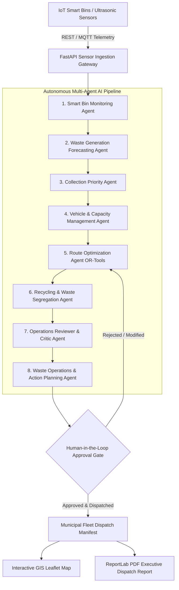
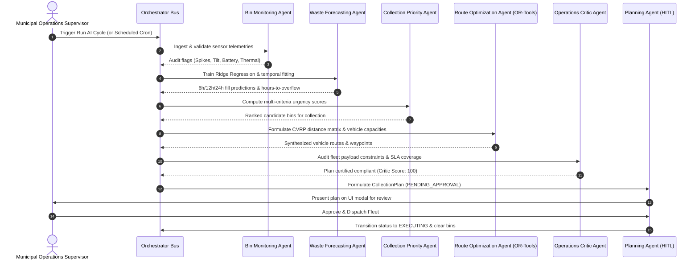

# Autonomous Agentic AI Smart Waste Collection & Recycling Optimization System

[](https://github.com)
[](https://developers.google.com/optimization)
[](https://scikit-learn.org)
[](https://fastapi.tiangolo.com)
[](https://react.dev)
[](https://pytest.org)

An enterprise-grade, end-to-end municipal decision-support system orchestrating **8 specialized AI agents** to monitor smart bin ultrasonic telemetries, forecast waste accumulation, prioritize pickups, optimize Capacitated Vehicle Routing (CVRP), analyze recycling contamination via Computer Vision, support Human-in-the-Loop approvals, and generate operational PDF reports.

---

## Table of Contents
1. [Architecture Overview](#architecture-overview)
2. [Multi-Agent Orchestration & Workflow](#multi-agent-orchestration--workflow)
3. [The 8 Specialized AI Agents](#the-8-specialized-ai-agents)
4. [Mathematical & Algorithmic Formulations](#mathematical--algorithmic-formulations)
   - [Capacitated Vehicle Routing Problem (CVRP)](#capacitated-vehicle-routing-problem-cvrp)
   - [Machine Learning Forecasting & Model Justification](#machine-learning-forecasting--model-justification)
   - [Multi-Criteria Collection Prioritization](#multi-criteria-collection-prioritization)
5. [Automated Test Suite (8 Test Cases)](#automated-test-suite-8-test-cases)
6. [API Reference Documentation](#api-reference-documentation)
7. [Frontend Architecture & GIS Map](#frontend-architecture--gis-map)
8. [Local Quickstart Guide](#local-quickstart-guide)
9. [Production Deployment Guide (Render & Vercel)](#production-deployment-guide-render--vercel)

---

## Architecture Overview



---

## Multi-Agent Orchestration & Workflow



---

## The 8 Specialized AI Agents

| # | Agent Name | Primary Responsibility | Key Inputs / Algorithms |
|---|------------|------------------------|--------------------------|
| **1** | **Smart Bin Monitoring Agent** | Sensor data ingestion, threshold validation, physical tilt & thermal monitoring, edge anomaly detection. | Ultrasonic fill %, strain-gauge weight, accelerometer tilt angle, thermometer °C. |
| **2** | **Waste Generation Forecasting Agent** | Time-series regression predicting fill velocity (%/hr) and hours-to-overflow countdown. | Scikit-learn Ridge Regression with temporal decay and diurnal weighting. |
| **3** | **Collection Priority Agent** | Multi-criteria urgency scoring (0–100) evaluating current fill, overflow ETA, and waste stream sensitivity. | Explainable linear utility function with decomposeable decision factors. |
| **4** | **Vehicle & Capacity Management Agent** | Fleet tracking, battery/fuel reserves, payload capacity enforcement, and waste-stream compatibility mapping. | Vehicle status, maximum payload ($kg$), supported waste types matrix. |
| **5** | **Route Optimization Agent** | Solves Capacitated Vehicle Routing Problem (CVRP) minimizing road distance, transit time, and emissions. | Google OR-Tools Routing Model, Haversine distance matrix, Clarke-Wright heuristic fallback. |
| **6** | **Recycling & Waste Segregation Agent** | Material purity analytics, cross-stream contamination detection, and municipal landfill diversion KPIs. | YOLOv8-WasteSeg optical vision simulator, bounding-box classification. |
| **7** | **Operations Reviewer / Critic Agent** | Independent audit watchdog validating generated plans against driver shift SLAs and vehicle weight ratings. | 0% overcapacity tolerance, critical bin coverage verification, route fatigue limits. |
| **8** | **Waste Operations & Action Planning Agent** | Aggregates outputs into actionable `CollectionPlan`, coordinates Human-in-the-Loop review, and dispatches fleet. | Plan lifecycle state machine (`PENDING_APPROVAL` → `APPROVED` → `EXECUTING` → `COMPLETED`). |

---

## Mathematical & Algorithmic Formulations

### Capacitated Vehicle Routing Problem (CVRP)

Let $G = (V, E)$ be a complete directed graph where:
- Vertex $0$ denotes the central municipal eco-depot.
- Vertices $V' = \{1, 2, \dots, n\}$ represent smart bins requiring collection.
- $K$ is the fleet of available utility vehicles, each with maximum payload capacity $C_k$.
- $q_i \ge 0$ is the waste demand (in $kg$) of bin $i \in V'$, with $q_0 = 0$.
- $c_{ij}$ is the travel distance between vertices $i$ and $j$ computed using the Haversine formula adjusted for city road grids:

$$\text{dist}(i, j) = 2 R \cdot \arcsin\left(\sqrt{\sin^2\left(\frac{\Delta \phi}{2}\right) + \cos(\phi_i)\cos(\phi_j)\sin^2\left(\frac{\Delta \lambda}{2}\right)}\right) \times 1.35$$

The CVRP is formulated as:

$$\min \sum_{k \in K} \sum_{i \in V} \sum_{j \in V} c_{ij} x_{ijk}$$

Subject to:
1. **Flow Conservation:**
   $$\sum_{j \in V} x_{0jk} = \sum_{j \in V} x_{j0k} = 1 \quad \forall k \in K$$
   $$\sum_{k \in K} \sum_{j \in V} x_{ijk} = 1 \quad \forall i \in V'$$
2. **Payload Capacity Enforcement:**
   $$\sum_{i \in V'} q_i \sum_{j \in V} x_{ijk} \le C_k \quad \forall k \in K$$
3. **Subtour Elimination (MTZ Formulation):**
   $$u_{ik} - u_{jk} + C_k x_{ijk} \le C_k - q_j \quad \forall i \neq j \in V', \forall k \in K$$

### Machine Learning Forecasting & Model Justification

**Model Selection:** Ridge Regression ($L_2$ Regularization) with Time-Series Feature Engineering.

**Justification:**
1. **Bounded Monotonic Growth:** Smart bin fill levels exhibit bounded accumulation $[0\%, 100\%]$ subject to ultrasonic sensor flutter. Unconstrained high-degree polynomial regression often produces runaway extrapolation oscillations (Runge's phenomenon).
2. **Noise Immunity:** The $L_2$ penalty term ($\alpha = 1.0$) suppresses parameter variance caused by momentary noise spikes without requiring complex neural architectures.
3. **Sub-Millisecond Deterministic Latency:** Ridge regression fits and evaluates in $< 0.5\text{ ms}$ per bin, enabling rapid continuous re-estimation across thousands of urban IoT nodes.

$$\hat{\beta} = \arg\min_{\beta} \left( \| y - X\beta \|_2^2 + \alpha \| \beta \|_2^2 \right)$$

The time-to-overflow countdown ($t_{\text{overflow}}$ in hours) is calculated as:

$$t_{\text{overflow}} = \frac{100 - \text{fill}_{\text{current}}}{\max(0.2, \text{fill\_rate}_{\%/\text{hr}})}$$

### Multi-Criteria Collection Prioritization

Each bin's priority score $P_i \in [0, 100]$ is computed via an explainable multi-factor formula:

$$P_i = \min\left(100, W_{\text{fill}} \cdot f_i + B_{\text{crit}} + W_{\text{pred}} \cdot \max(0, 20 - t_{\text{overflow}}) + W_{\text{waste}} + W_{\text{health}}\right)$$

Where:
- $W_{\text{fill}} \cdot f_i = 0.50 \times \text{current\_fill\_pct}$
- $B_{\text{crit}} = 25.0$ if $\text{fill} \ge 85\%$, else $15.0$ if $\ge 70\%$
- $W_{\text{pred}} = 20.0$ if $t_{\text{overflow}} \le 6\text{h}$, $12.0$ if $\le 12\text{h}$
- $W_{\text{waste}} = +15$ (Hazardous), $+12$ (Organic/Odor), $+6$ (Recyclable), $+4$ (General)
- $W_{\text{health}} = +15$ if tilted ($>15^\circ$), $+12$ if thermal anomaly flagged

---

## Automated Test Suite (8 Test Cases)

All 8 functional test requirements are covered by automated unit & integration tests in `backend/tests/test_smart_waste_suite.py`:

| # | Test Case Function | Requirement Verified | Assertions & Validation Criteria | Result |
|---|-------------------|----------------------|-----------------------------------|--------|
| **1** | `test_high_fill_bin_prioritization` | High fill bin prioritization | Bin with 92% fill scores $> 50$, ranks #1 over low bin (25%), includes severe fill rationale. | **PASSED** |
| **2** | `test_forecast_predictive_collection` | Forecast-based predictive collection | Moderate bin (66%) with high fill rate ($>3\%/\text{hr}$) projects overflow $\le 12\text{h}$ and receives elevated priority. | **PASSED** |
| **3** | `test_sensor_anomaly_detection` | Sensor anomaly detection & quarantine triggers | Quarantines $>100\%$ fill, detects tilt $>15^\circ$ as `TILTED`, flags $+60\%$ surge as `SPIKE`. | **PASSED** |
| **4** | `test_multi_bin_route_optimization` | Multi-bin route optimization validation | CVRP solver routes 3 bins to Alpha Truck starting at Depot and terminating at Depot with non-zero distance. | **PASSED** |
| **5** | `test_vehicle_capacity_enforcement` | Vehicle capacity enforcement | Total assigned payload $\le$ vehicle $700\text{kg}$ limit; Operations Critic audits zero overload violations. | **PASSED** |
| **6** | `test_waste_type_compatibility` | Waste-type compatibility checking | Recyclable bin is strictly assigned to dedicated Recycle Truck, never to General-only compactor. | **PASSED** |
| **7** | `test_dynamic_replanning_on_critical_bin` | Dynamic replanning triggered by new critical bins | Injecting emergency spike ($99\%$) into BIN-004 triggers replan and immediately routes BIN-004 for pickup. | **PASSED** |
| **8** | `test_collection_state_updates` | Successful collection & state updates | Servicing bins clears fill to $\le 5\%$, sets `status = NORMAL`, timestamps `last_collected_at`, drops priority $\le 10$. | **PASSED** |

---

## API Reference Documentation

### Smart Bins & Fleet
- `GET /api/bins`: List all smart bins (optional query filters: `waste_type`, `status`, `zone`).
- `GET /api/bins/{bin_id}`: Retrieve detailed telemetry and historical readings for a specific bin.
- `POST /api/bins`: Register a new smart bin node.
- `GET /api/vehicles`: List all vehicles with battery/fuel, status, payload, and compatibility.
- `GET /api/kpis`: Return system-wide operational KPIs and active plan statistics.

### IoT Sensor Telemetry
- `POST /api/sensors/ingest`: Ingest real-time sensor packet (`fill_pct`, `weight_kg`, `battery_pct`, `temperature_c`, `tilt_angle_deg`) with anomaly auditing.
- `POST /api/sensors/simulate-tick`: Advances simulated city time forward, applying realistic diurnal fill increments.
- `POST /api/sensors/inject-spike`: Injects an emergency overflow surge (e.g., 99%) into a specific bin.
- `POST /api/sensors/mark-collected`: Empties serviced bins and updates physical collection timestamps.

### Multi-Agent Orchestration & Replanning
- `POST /api/agents/run`: Runs the complete sequential 8-agent AI decision pipeline.
- `GET /api/agents/logs`: Streams recent inter-agent audit logs and reasoning trails.
- `POST /api/agents/replan`: Dynamically replans routes in response to an edge trigger (`CRITICAL_BIN`, `VEHICLE_BREAKDOWN`).

### Human-in-the-Loop & Reporting
- `GET /api/plans/active`: Fetch the latest generated collection plan.
- `POST /api/plans/action`: Execute HITL decision (`APPROVE`, `REJECT`, `MODIFY`, `DISPATCH`, `COMPLETE`).
- `POST /api/recycling/cv-analyze`: Run optical YOLOv8 Computer Vision contamination inspection.
- `GET /api/reports/pdf`: Generate and download the official municipal executive PDF dispatch report.

---

## Frontend Architecture & GIS Map

The frontend is built with **React 18 + TypeScript + Vite + Tailwind CSS + Leaflet**:

1. **Interactive GIS Map (`GISMap.tsx`):**
   - High-contrast geospatial display of municipal district.
   - Smart bin markers color-coded dynamically (Rose for Critical $\ge 85\%$, Amber for Warning $\ge 70\%$, Emerald for Normal $< 70\%$, Purple for Tilted).
   - Real-time CVRP route polylines color-coded by stream (Sky Blue: General, Emerald: Recyclable, Amber: Organic) with numbered waypoint badges.
   - Depot and Materials Recovery Facility (MRF) markers.
2. **Executive KPI Dashboard (`KPIDashboard.tsx`):**
   - Monitored Bins, Critical Overflow Risk count, Active Fleet Utilization, Scheduled Payload, Route Distance, CO2 Emissions Saved, Landfill Diversion Rate.
3. **Human-in-the-Loop Operations Gate (`HITLApprovalModal.tsx`):**
   - Plan approval, rejection notes, fleet dispatching, and simulation completion actions.
   - Critic Audit Score badge and breakdown of dispatched routes with payload utilization progress bars.
4. **Agent Orchestrator Visualizer (`AgentVisualizer.tsx`):**
   - 8-agent pipeline grid and searchable agent reasoning audit log console.
5. **Dynamic Edge Replanner (`DynamicReplanPanel.tsx`):**
   - Live simulator for emergency overflow spikes and vehicle breakdowns.
6. **Computer Vision Recycling Inspector (`RecyclingCVInspector.tsx`):**
   - Optical object detection and contamination percentage analysis.

---

## Local Quickstart Guide

### Prerequisites
- Python 3.10+ (Tested on Python 3.14)
- Node.js 18+ and npm

### 1. Backend Setup
```bash
cd smart-waste-system/backend
# Install dependencies
pip install -r requirements.txt

# Run automated tests
pytest tests/test_smart_waste_suite.py -v

# Start FastAPI backend server
uvicorn app.main:app --host 0.0.0.0 --port 8000 --reload
```
API Documentation will be available at: `http://localhost:8000/docs`

### 2. Frontend Setup
```bash
cd smart-waste-system/frontend
# Install npm dependencies
npm install

# Start Vite development server
npm run dev
```
Open your browser at: `http://localhost:5173`

---

## Production Deployment Guide (Render & Vercel)

### Deploying Backend to Render
1. Create a new **Web Service** on [Render](https://render.com).
2. Connect your GitHub repository.
3. Configure settings:
   - **Root Directory:** `backend`
   - **Environment:** `Python 3`
   - **Build Command:** `pip install -r requirements.txt`
   - **Start Command:** `uvicorn app.main:app --host 0.0.0.0 --port $PORT`
4. Set Health Check path to `/health`.

### Deploying Frontend to Vercel
1. Create a new Project on [Vercel](https://vercel.com).
2. Import the repository and set:
   - **Root Directory:** `frontend`
   - **Framework Preset:** `Vite`
   - **Build Command:** `npm run build`
   - **Output Directory:** `dist`
3. In `frontend/vite.config.ts`, update the API proxy or set environment variable `VITE_API_BASE_URL` pointing to your deployed Render backend URL.
